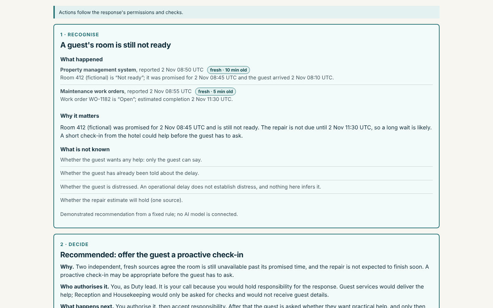
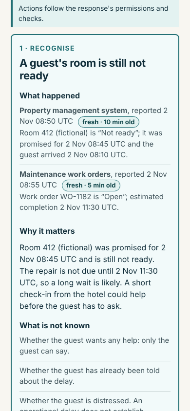
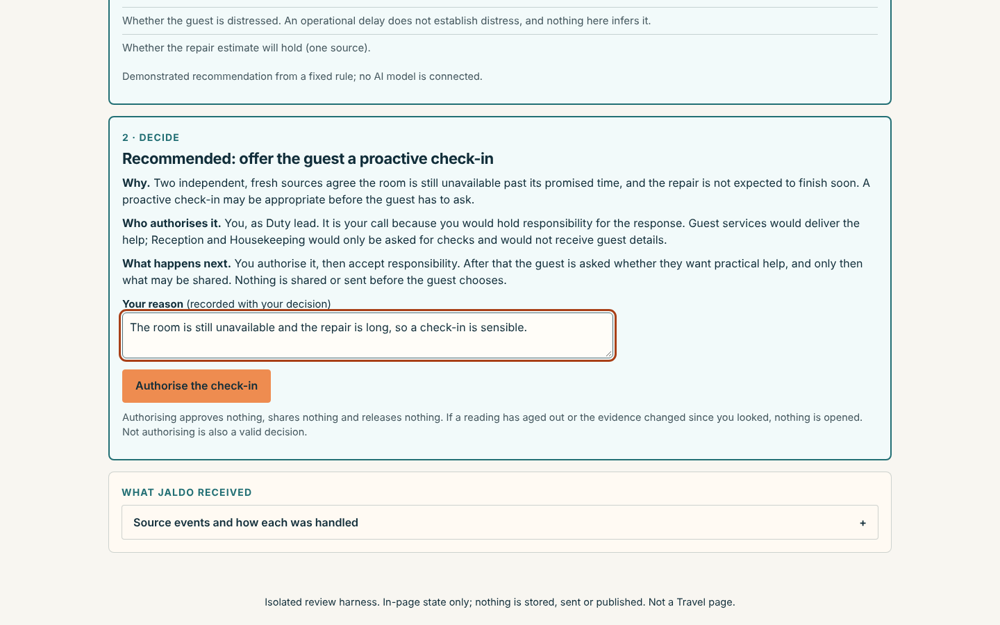
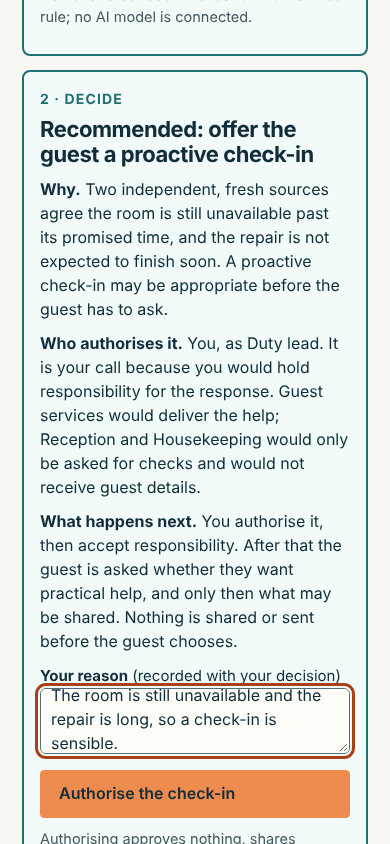
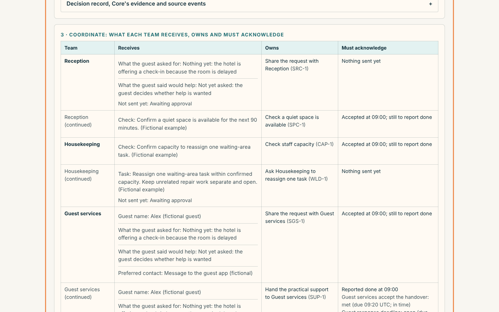
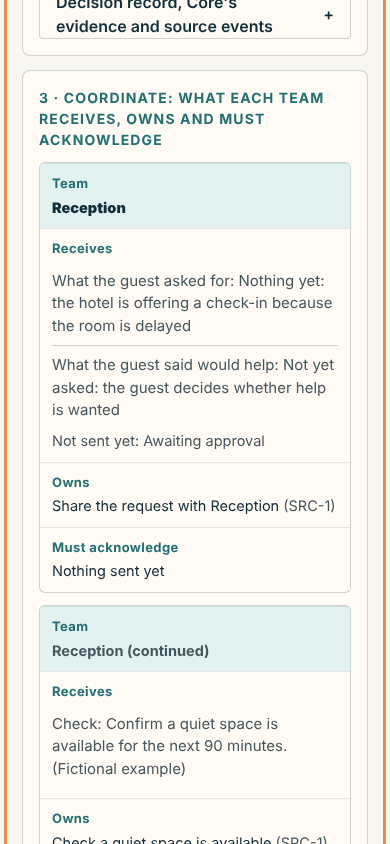
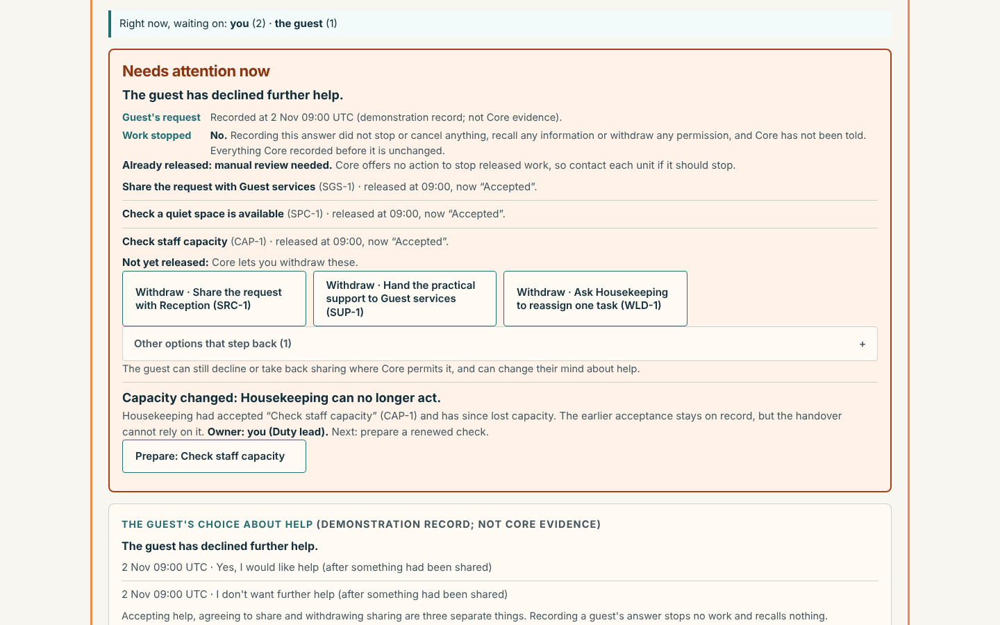
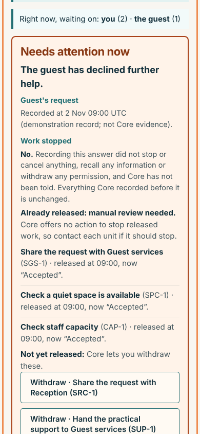
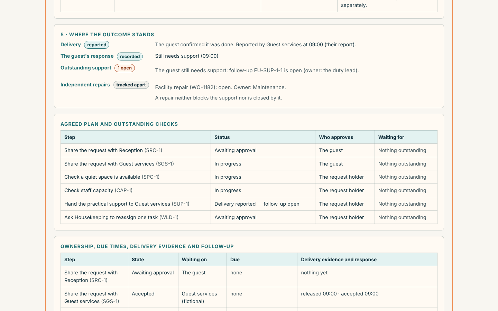
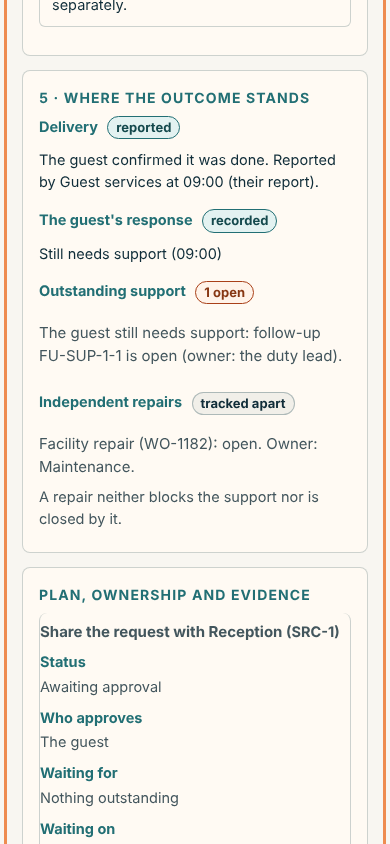

# JALDO Travel: five-moment walkthrough (PR #53, draft)

A hotel decision-maker's first look at the workspace. Every screenshot is from the final packaged HTML, with fictional data, a synthetic clock and simulated delivery. One desktop (1440 px) and one mobile (390 px) view per moment.

## 1 · Recognise: What happened, why it matters, what is not known

The Duty lead opens the workspace and sees a conclusion first: a guest's room is still not ready. Two fictional reports (property system, maintenance) are given with their source, time and freshness, then why it matters (promised 08:45, repair not due until 11:30) and what is **not** known: whether the guest wants help, has been told, or is distressed. A delay is never read as distress.

- **Was unclear:** Conclusion buried under a six-column event table with engine words (“Taken in”, “Superseded”, “Freshness”, an event-envelope paragraph).
- **Changed:** Conclusion, what happened, why it matters and what is unknown come first. The events table sits behind “Source events and how each was handled” with plain words (Used / Not used: older than the current reading / Refused: not valid). Event-checking detail moved to the reviewer disclosure.

## 2 · Decide: The recommended response, who authorises it and why

JALDO recommends offering the guest a proactive check-in, says why, says **who authorises it** (the Duty lead, because they would hold responsibility), what happens next, and asks for the reason that will be recorded. Nothing is shared or sent by authorising.

- **Was unclear:** The button read “Open a proactive check-in for me to review”, and who decides and what follows were one dense paragraph.
- **Changed:** Three labelled lines (Why · Who authorises it · What happens next), a plain “Your reason” box, and the button “Authorise the check-in”. After authorising, a “Right now, waiting on: you (1)” line names who must act next.

## 3 · Coordinate: What each team receives, owns and must acknowledge

One table, by team: the exact details each team receives (or “Not sent yet”), the step it owns, and what it must acknowledge. Reception and Housekeeping get only checks, with no guest details; Guest services gets the guest's details only after the guest agreed; Maintenance owns an independent repair and records its own status.

- **Was unclear:** Coordination was spread across three tables (plan, ownership, disclosure) and a reader had to join them.
- **Changed:** Added “who has what” as one table (cards on mobile). The plan and ownership tables stay below for detail.

## 4 · Adapt: Capacity disappears; the guest declines further help

Two things changed after work was under way. Housekeeping lost capacity (the earlier acceptance stays on record; the owner and the next action are named). The guest said they don't want further help: the page shows **“Guest's request: recorded”** and **“Work stopped: No”** as separate facts, lists released steps for manual review, and shows Core's withdraw buttons for what has not been released.

- **Was unclear:** The capacity wording was Core's: “Renew Capacity check (CAP-1): its recipient lost capacity after accepting”. The same button appeared twice, and the withdraw options were tucked inside collapsed sections under a line saying “Core lets you withdraw these”.
- **Changed:** Plain capacity wording naming the team, the step, the owner and the next action; each response appears once; withdraw options are visible; long manual-review lines shortened.

## 5 · Establish the outcome: Delivery, the guest's response, outstanding support and independent repairs

Four separate lines, never merged: delivery (the unit's report), the guest's response (“Still needs support”), outstanding support (follow-up open, owned by the Duty lead) and independent repairs (the facility repair stays open, and neither blocks the support nor is closed by it).

- **Was unclear:** Delivery, feedback and resolution were visible only inside a table cell and a long process review.
- **Changed:** A four-line outcome summary with status chips. The process review is now collapsed beneath it for authorised review.

## Findings

| Kind | Finding | Outcome |
|---|---|---|
| Confusing wording | Engine words on staff screens (“Taken in”, “Superseded”, “envelope”, “Freshness”, contract and gap references). | Fixed: plain words on screen; technical statements moved to Review tools › Technical review details. |
| Confusing wording | “Open a proactive check-in for me to review”; Core's “Renew Capacity check (CAP-1): its recipient lost capacity after accepting”. | Fixed: “Authorise the check-in”; capacity wording names the team, step, owner and next action. |
| Unnecessary step | Authorise, then Accept responsibility, look like one step done twice. | Kept, and explained: accepting is Core's own command for the accountable holder, with its own authority, conflict and capacity checks. The page now says what comes next and who is waited on. |
| Unclear next person | Nothing said who the response was waiting on. | Fixed: “Right now, waiting on: you (2) · the guest (1)”, taken from Core's own list of what is waiting. |
| Unclear next action | The same response (e.g. renew the capacity check) appeared in two places; withdraw options were hidden in collapsed sections. | Fixed: each response appears once; withdraw options are visible. |
| Unclear outcome | Delivery, the guest's response and resolution were spread over tables and a long review. | Fixed: four-line outcome summary; process review collapsed. |
| Left as is | The Duty lead's page is still long on a phone (plan, ownership and disclosure tables). Role switching lives in Review tools (now labelled “switch role here”). The guest is asked about help only after the Duty lead accepts responsibility. | Noted. Not changed: shortening the tables would drop evidence; the guest timing follows the accept step by design. |

Technical details (event checking, adoption evidence, help answers, contract status, gaps) are in the reviewer disclosure: Review tools › Technical review details. See also CORE-GAPS.md.
